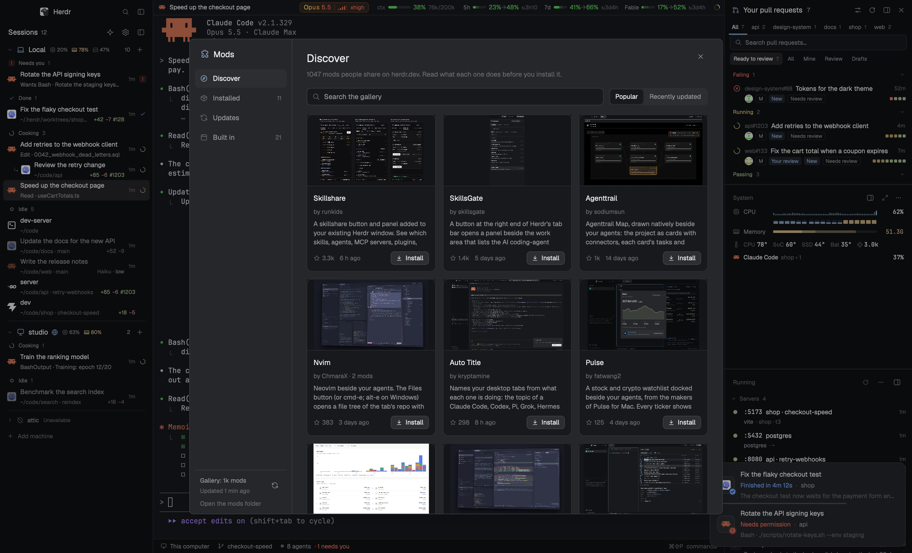

# Mods

One screen for every Herdr mod: browse the gallery on herdr.dev, read what a mod's code can
reach before installing it, and manage installed mods (turn off and on, update, roll back,
remove with undo). Herdr's own mods are listed too, with a way to duplicate them.

## What you see

A modal dialog (`overlay: { kind: "dialog", width: 1040, height: 0.86, modal: true }`), styled
like Herdr's Settings: every color from `theme()`, so light and dark themes both work.

- **Rail**, 200 px, `border` on its right: a puzzle icon and "Mods" (16 px semibold); four
  pages, 13.5 px, each a 15 px icon and a title, the shown one on `raised`:
  Discover, Installed (the count of your mods), Updates (an `accent` pill with the count of
  updates, or a spinner while checking), Built in (the count of Herdr's mods). At the foot,
  above a `border` line: "Gallery: 757 mods" and "Updated 2 min ago" (or "Couldn't refresh" in
  amber), a refresh button, and an "Open the mods folder" link.
- **Page header:** title 21 px semibold, a 13 px `dim` line under it, actions at the right, then
  a close button. Detail pages have a "← Discover" or "← Installed" link instead.
- **Discover:** a 34 px search field and a Popular / Recently updated segmented switch; a grid
  of cards, as many 228 px-minimum columns as fit, 14 px apart, cards stretched to fill each
  row. A card: the listing's preview (56% of the card's width; a pulsing block while it loads,
  else the mod's tile and "No preview"), then its name (14 px semibold), "by owner · N mods",
  three lines of its blurb, and a footer with stars, last push, and Install, Update or an
  "Installed" chip. 24 cards, then "Show more (N left)". Skeleton cards while the index loads;
  an empty state with Try again when it can't be reached.
- **A listing's page:** the preview (up to 560 px, click for full size on a dark backdrop) beside
  the name (24 px), owner, stars, last update, blurb, and Install / Update / Installed + Open +
  Manage, and GitHub. Below: the mods in the listing as chips (a check on installed ones,
  "name → name-2" when renamed), a line when it comes with keys, then the recipe's sections for
  people ("What you see", "How it behaves") as markdown, and a fold with the whole recipe.
- **Installed:** a filter field, then groups (Yours, Copies of Herdr's mods, Turned off), and
  Removed (kept for 30 days). A row: a 36 px tile (the listing's preview, else the initial on a
  color from the terminal palette), the title with a version chip, then "name · source · where it
  shows" (with "· hidden" when every block of it in the shown layout is hidden); chips for Error,
  Update, Edited; a small Hide or Show button when the shown layout has a block of it; a switch.
  Removed rows have Restore and Delete. Built in rows have the same Hide or Show beside Duplicate.
- **A mod's page:** a 56 px tile, title, version, "name · source"; Hide or Show (when the shown
  layout has a block of it), Open (window) or Open beside (panel), and the switch. Notices for Herdr's errors, an update (with the files that changed),
  edits since install, and for this screen and for Herdr's own mods. Facts in rows, a 120 px
  label on the left: About, Shows in (each layout and block; a block in the shown layout has a
  Hidden chip when hidden, and its own Hide or Show), Keys (as ⇧⌘M), Used by, Source
  (repo and commit, See the listing, Unlink; or listings with the same folder name to Link),
  Folder (with Show in Finder), Earlier copy (with Roll back). Then "Remove this mod".
- **Updates:** Check now and Update all; "Ready to update" rows with "abc1234 → def5678" and the
  files changed; "Not linked to the gallery" rows with Link.
- **Built in:** Herdr's mods with where they show, and Duplicate.
- **Install review**, a 600 px sheet over a dimmed page: "Install <name>?", the repo and commit;
  the mod folders it adds (checkboxes when a listing has several), each with its file count, a
  rename or reinstall note, and where it shows ("docks on the left of your layout right away",
  "opens as a window when you ask"); "What its code can do" (one line per finding with an icon
  and the count of places, unfolding to `path:line` and the line); the keys it adds and the ones
  it leaves to you; Cancel and Install.
- **Snack**, bottom center: a check or alert icon, the message, an action (Undo, Open, Roll back),
  and a close button. It goes after 7 seconds.

## How it behaves

- **Esc** closes the full-size picture, then the review, then the detail page, then the dialog.
  ⌘F or / focuses the page's search field.
- **Gallery:** `https://assets.herdr.dev/mods/index.json`, cached in `mod-hub/cache/` and
  refetched when older than 30 minutes. Search scores name, mod folder names, owner and blurb.
  Previews download to `mod-hub/cache/previews/`, six at a time, only for cards drawn. A recipe
  comes from `raw.githubusercontent.com/<repo>/<commit>/<path>/RECIPE.md`.
- **Install:** download `codeload.github.com/<repo>/tar.gz/<commit>` into `mod-hub/staging/`
  with `curl` and `tar`, refusing it if `find` sees a link or special file in the mod folders,
  the listing's `keys.json` or a folder on the way to them (a link could point at the person's
  files; links elsewhere in the repo are never read); read every `.js` file for the review, 4000 lines at a time with a file
  call between pieces (Herdr stops a script after about half a second). On Install: copy each
  picked mod into staging under its target name, rewriting `mods/<old>/`, `mod.open:<old>`,
  `mod: "<old>"` and `"<old>.<command>"` when renamed; `herdr-app check` every one; only then
  move them into `mods/`, record the listing, commit and file fingerprints in `state.json`, and
  merge the listing's `keys.json` (adding only keys not already bound; none when the person has
  no `keys.json`). A folder is only ever replaced when it's this listing's earlier install; one
  that appeared while the review was open stops the install. Names in Removed count as taken.
  Then show the mod's page.
- **Hide / Show:** the lighter switch, for the shown layout only, with no file written: Hide runs
  `layout.hide` on each showing block of the mod (or the column or stack it is alone in, and any
  column that leaves empty, never one holding the tabs); Show runs `layout.show` on each hidden
  node above it and `layout.select` for a stack. The mod keeps running. A snackbar says what
  changed, and its Undo reverses only the blocks that action changed.
- **Turn off:** take the mod out of your own layouts (a copy of one of Herdr's mods hands its
  blocks back to the original; any other block is removed and a group it emptied is hidden; a
  pane or stack header goes back to Herdr's tabs), take its keys out, and move its folder to
  `mod-hub/off/`, recording each change. Every file is read first: one that isn't valid JSON
  stops it with nothing changed, and a failed write undoes the ones made. A removed block
  remembers its siblings, counting ones other mods took out, so blocks turned on in any order
  land where they were; a group emptied and hidden shows again when a block comes back.
  **Turn on** moves it back and replays the record in reverse, dropping any block Herdr placed on
  its own when the folder reappeared; what can't go back is reported and kept as `pending`, with
  **Try again** on the mod's page. A mod named like one of Herdr's command groups (`tab`,
  `terminal`…) never owns `tab.*` bindings.
- **Remove:** the same, into `mod-hub/removed/<id>/` with its `data/<mod>` and its earlier
  copies; Restore within 30 days; older ones are deleted on the next open. Restore refuses while
  a mod of that name is installed or turned off; if `data/<mod>` exists by then, the old data
  stays under Removed instead.
- **Updates:** for each linked mod whose listing's commit moved, download it and compare file
  fingerprints (FNV-1a) of the renamed copy with what was installed; equal means a silent commit
  bump. Update backs up the current folder (keeping 3), installs the new one the same way (the
  backup comes back if the move fails), and keeps the mod off if it was off. Roll back is
  offered only when the backup came from the same listing, and the copy it replaces becomes the
  next backup.
- **Every change** runs one at a time, and none runs while `state.json` can't be read; every
  layout, `keys.json` and `state.json` write uses `writeTextFile` against the text it read, and
  is read again and redone (up to three tries) if the file changed meanwhile. Reading never
  writes: records of mods deleted by hand are dropped by a tidy job in the same queue.
- **Watching:** a change in `mods/` (an agent, a terminal) rescans after 600 ms.

## Built from

- `mods/mod-hub/mod.json`: `{ "place": "none", "title": "Mods", "overlay": { "kind": "dialog",
  "width": 1040, "height": 0.86, "modal": true } }`.
- `main.js` (the View), `hub.js` (`class Hub` with injected `exec`, `fs`, `fetch`, `writeText`,
  `readText`, `check`), and pure modules: `catalog.js`, `layouts.js`, `keys.js`, `review.js`,
  `manifest.js`, `inventory.js`, `ui.js`; `icons/` holds 34 line icons.
- Sizes from `on_size_change` include Herdr's zoom (`settings().zoom`); divide before laying out.
- Herdr's engine compares strings by code unit even in `localeCompare`: sort on folded case.
- `keys.json` at the repo root: `{ "global": { "cmd-shift-m": "mod.open:mod-hub" } }`.
